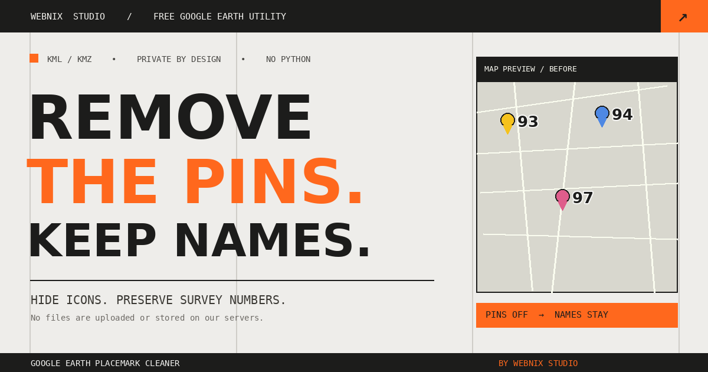

# Google Earth Placemark Cleaner

**Remove Google Earth placemark icons without deleting the names.** A free, privacy-first KML/KMZ cleaner built by **WEBNIX STUDIO**.

[](https://nakulkpadi.github.io/GOOGLEEARTH-PLACEMARK-CLEANER/)
[](#privacy--security)



## What does it do?

Google Earth Pro maps can become crowded with colorful yellow, blue, red, pink, and custom pushpins or paddle/teardrop icons. This application hides **only selected named Point placemark icons** and keeps their labels, coordinates, and map geometry.

**Live site:** https://nakulkpadi.github.io/GOOGLEEARTH-PLACEMARK-CLEANER/

### Features

- Import `.kml` or `.kmz` files, including KMZ archives with attachments.
- Detect standard Google Earth icon colors, styles, pushpins and paddle icons.
- Select icon colors, individual survey numbers, or all eligible named Point placemarks.
- Search within placemark names, source KML files, and icon types.
- Keep Gujarati/Unicode names, coordinates, lines, polygons and shared style definitions.
- Set your output name, then **Save As** (where supported) or **Download**.
- Runs in a modern browser without Python, Node, databases, accounts, or a backend.
- Service worker caches public tool assets for later offline access, where supported.

## Quick start — Google Earth Pro

1. In Google Earth Pro, right-click your folder under **Places** and choose **Save Place As…**.
2. Export a `.kmz` or `.kml` file.
3. Open the [web tool](https://nakulkpadi.github.io/GOOGLEEARTH-PLACEMARK-CLEANER/) and drop the file into its import area.
4. Check the colors or individual placemarks whose icons you want hidden; leave other icons unselected.
5. Type the desired output name, then choose **Save As…** or **Download**.
6. Open the resulting file in Google Earth Pro and uncheck your original folder to avoid duplicate pins.

**Important:** This is visual icon hiding, not deletion. The KML file retains the selected Placemark entries and names. The tool applies an inline `<IconStyle><scale>0</scale></IconStyle>` and sets `<LabelStyle><scale>1</scale></LabelStyle>` for each selected eligible Placemark, so shared styles used by other features are not changed.

## Offline / portable Windows use

Download the repository ZIP (`Code` → `Download ZIP`), extract it, then open `index.html` in Edge/Chrome or double-click `START_TOOL_WINDOWS.cmd`. Keep the `assets/` folder with the HTML file. No Python installation is required.

## Privacy & security

**We do not upload, collect, retain, or store your map files on WEBNIX STUDIO servers.**

- File reading and KMZ compression happen locally via the browser File APIs and bundled JSZip library.
- The application contains **no map upload endpoint**, analytics, login, or tracking scripts.
- Static hosting (such as GitHub Pages) and the browser may process normal network requests for public page assets and retain routine request logs. The KML/KMZ file contents are **never included in those requests**.
- Exported output is created in browser memory and saved by your browser directly to your device.
- Service worker caches only public application assets. It does **not** cache user-selected map files.
- The tool caps input file size at 300 MB. Large/compressed archives may use significant local memory. Use the app only with files from trusted sources, and verify critical GIS output manually.

See [PRIVACY.md](PRIVACY.md) for the plain-language privacy promise and limits.

## Local development

There is **no build pipeline**. The repository is a static website; all scripts and dependencies are committed locally.

```bash
# With Python installed for development only — end users do not need Python:
python -m http.server 8000
# Visit http://localhost:8000
```

Or simply open `index.html`. The bundled `assets/jszip.min.js` is a third-party dependency licensed under MIT/GPLv3 (see [LICENSE_JSZIP.txt](LICENSE_JSZIP.txt)). The site and original tool code are MIT-licensed unless otherwise noted.

## GitHub Pages deployment

The project is arranged for **GitHub Pages** from repository root. In the repository settings:

1. Open **Settings → Pages**.
2. Under *Build and deployment*, choose **Deploy from a branch**.
3. Set branch **main** and folder **/(root)**, then **Save**.
4. GitHub Pages will publish to https://nakulkpadi.github.io/GOOGLEEARTH-PLACEMARK-CLEANER/ (deployment may take a little while).

The canonical tag, social banner, `robots.txt`, `sitemap.xml`, and FAQ / WebApplication structured data are already prepared for this URL. Google indexing depends on the published page being crawlable; metadata does not guarantee rankings or indexing. Submit the public sitemap to Google Search Console if desired.

## Search phrases this tool helps answer

- How to remove placemark icons in Google Earth without removing names
- Google Earth show names but hide pushpins
- Remove yellow and blue placemarks from KMZ files
- Hide Google Earth paddle icons but keep survey numbers
- Free online KML or KMZ icon remover with no uploads

## Compatibility and limits

- Intended for **named Point placemarks** in Google Earth-style KML/KMZ files; boundaries and non-point geometries are skipped.
- Icon color classification is based on known Google Earth icon URLs and IconStyle tint values; unidentified custom icon images are grouped as *Other / Custom*. Not every icon image can be color-inferred perfectly.
- Names, coordinates, and non-point geometry are retained in output. Google Earth Pro label behavior can depend on local application styling and display settings.
- Use the original exported file as backup; output files are separate.
- **Save As** uses the browser File System Access API when available; otherwise it downloads normally.

## Disclaimer

This is an **independent tool** created by WEBNIX STUDIO. It is **not affiliated with, endorsed by, or sponsored by Google LLC**. Google, Google Earth, and related marks are trademarks of their respective owners. Do not use a cleaned map as a legal/cadastral survey without validating it against authoritative land records.

## Credits

**APP CREATED BY WEBNIX STUDIO** — https://www.webnixstudio.in

Project: https://github.com/nakulkpadi/GOOGLEEARTH-PLACEMARK-CLEANER
